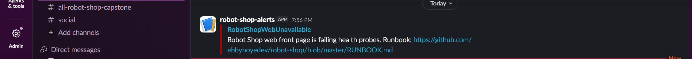

# Postmortem: Robot Shop front page down after a bad release

**Date:** 28 October 2026 
**Status:** resolved
**Type:** self-run incident drill.I introduced the fault myself to test the alert, the runbook and the rollback. The cause was known to me in advance. Detection and mitigation were done by following the runbook.

## Summary

A Helm release changed the label selector of the `web` Service so that it matched no pods. The shop's front page stopped answering while every pod still looked healthy. The `RobotShopWebUnavailable` alert fired in Slack about two minutes after the release. Rolling back to the previous revision restored service. The front page was down for about 13 minutes.

## Impact

- The shop's front page failed its health probes from release until recovery: about 13 minutes (19:54 to 20:06, measured to the time of Slack's resolved message, which lags the real recovery slightly).
- That is roughly 3% of the 30-day error budget (13 of 432 minutes). It is below the 25% threshold in `SLO_AND_ERROR_BUDGET_POLICY.md` that requires a postmortem, and I wrote one because this was a drill.
- No real users were affected.

## Timeline

| Time | Event |
|---|---|
| 19:49:05 | Drill starts. Baseline check: all pods `1/1 Running`, revision 4 is `deployed`. |
| 19:53:25 | Fault prepared: the `selector` in `K8s/helm/templates/web-service.yaml` changed from `service: web` to `service: web-v2`. |
| 19:54:09 | `helm upgrade` deploys revision 5. Helm reports `Upgrade complete`. Pods look healthy. |
| about 19:54 | Front page starts failing its health probes. The load generator pod goes into `CrashLoopBackOff`. |
| 19:56:09 | Alert `RobotShopWebUnavailable` arrives in Slack with the runbook link. |
| 19:56 to 20:02 | Following the runbook: pods checked (healthy apart from the load generator), `helm history` checked. Revision 5 is the only recent change. |
| 20:02:05 | Mitigation: `helm rollback robot-shop 4`. Helm reports success. |
| 20:06:52 | Resolved message arrives in Slack. |

## Detection

The alert fired about 2 minutes after the release. That is the expected delay: probes run every 15 seconds, the rule waits one minute, and Alertmanager groups before sending.



## Response

The runbook order worked. I looked at the pods first, which showed nothing wrong, and then at the release history, which pointed straight at revision 5. I mitigated with a rollback before looking for the cause. The rollback took about 5 minutes from the alert to the command, mostly spent checking pods and history.

## Root cause

In revision 5, the `web` Service selector was changed from `service: web` to `service: web-v2`. No pod carries that label, so the Service had no endpoints and nothing could reach the web pod. The `diff` of the manifests of revisions 4 and 5 shows this as the only change:

```
< service: web
> service: web-v2
```

Checking the Service's endpoints after the rollback showed `172.31.89.24:8080` where an empty `<none>` would have been during the fault. I did not capture the empty state during the incident, and the manifest diff is the evidence for the cause.

## Contributing factors

- Helm reported success because it checks that the objects were created, not that the app answers. Pod readiness stayed green because the pods themselves were fine.
- Nothing in the pipeline or the release process checks that a Service has endpoints after a change.
- The only pod-level symptom was the load generator crash-looping, which is easy to miss.

## What went well

- The alert fired, reached Slack, and linked to the runbook.
- The runbook's order (acknowledge, check pods, check recent changes, mitigate, then investigate) led to the cause quickly.
- `helm rollback` restored service with one command.

## What went less well

- About 6 minutes passed between the alert and the rollback. Part of that was reading the pod list, which showed no problem.
- The resolved message lags the real recovery, so the measured downtime is slightly overstated.

